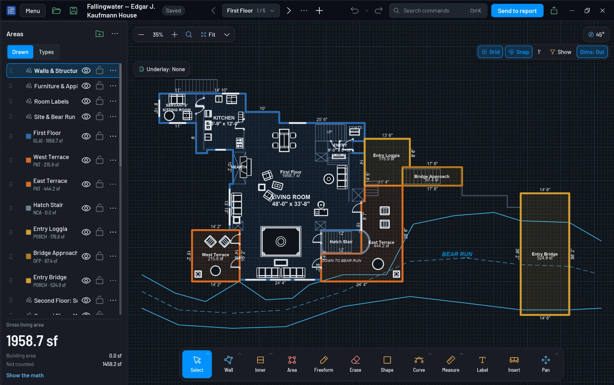

# Sketch Rust

A native Windows floor-plan sketching program for appraisers: draw walls to scale,
define areas, and get living-area and building-area calculations.



## Install

Download the latest release and use one of:

- **Installer** — `SketchRust-<version>-x64.msi` (a Windows Installer package built with
  WiX Toolset 5). Installs for the current Windows user (no administrator permission), with
  a licence page, a choice of folder, an optional desktop shortcut and a Start Menu shortcut.
  Later versions upgrade it in place, and it is removed from Windows Settings > Apps >
  Installed apps. It opens `.sketchie` and `.skx` files on a double click and adds Sketch
  Rust to **Open with** for `.json` (so `.sketchie.json` files open with it), and lists the
  Fallingwater demo under Recent sketches on the first start. Silent install: `msiexec /i SketchRust-<version>-x64.msi /qn`.
- **Portable zip** — `SketchRust-<version>-native-preview-<date>-windows-x64.zip`.
  Extract it anywhere and run `sketch-app.exe`.

The downloads are not code-signed, so Windows SmartScreen may warn before running
them. Each has a `.sha256` file to check the download against.

Requires 64-bit Windows 10 or 11.

## Using it

Help is built in: **Help > User Guide** covers drawing, areas, symbols, printing and
saving. **Help > Keyboard Shortcuts** (F1) lists the keyboard shortcuts.

Quick start: press `E`, click a start point, type a length and press an arrow key for
each wall, press `A` to close the area, then pick what the area is in the Define Area
panel (`F4`).

Sketches save as `.sketchy` files in the open Sketchy format, and every save is kept as
a version. `.sketchy.json` files open too.

### Appraise-It Pro reports

On Windows, open a saved, editable report in Appraise-It Pro. In Sketch Rust,
choose **Help > Appraise-It Reports > Check open report**, select the report
in SFREP's session picker, then choose **Preview sketch** and **Send sketch images**.
Sketch Rust adds each nonblank page to **Additional Sketch(es)** in UAD 3.6
reports or to a new **Sketch** addendum in legacy reports that support them.
You can also send living-unit area totals for an eligible UAD 3.6 report.
Enter legacy area totals directly in Appraise-It Pro. Review the result
and save the report there.

Keep the editable sketch in Sketchie or SKX. Use **File > Export as PNG** or
**File > Export as PDF** for a report attachment where your form supports it,
and enter the area totals in Appraise-It Pro. Legacy AXF sketches open here
as a converted copy (areas, arc walls and labels; see
[docs/AXF_IMPORT.md](docs/AXF_IMPORT.md)); Sketch Rust does not write AXF, so
use the licensed Apex application for AXF workfiles you need to keep editing
there.

See the [Appraise-It Pro integration guide](docs/APPRAISE_IT_PRO_INTEGRATION.md)
for requirements and guidance for users of older previews.

## Build from source

Requires the Rust toolchain (stable). On Windows, use the MSVC target and the Windows SDK (`rc.exe`).

```
cargo build --release -p sketch-app
cargo test --workspace
```

- **macOS (Apple Silicon)** — see [docs/MACOS.md](docs/MACOS.md) for `cargo run` and `./tools/package-macos.sh`.
- `tools\package.ps1 -NativePreview` builds the portable zip into `dist\`.
- `tools\installer.ps1` builds the zip and then `dist\SketchRust-<version>-x64.msi`
  (source in `installer\`). Run it once with `-FetchWix` to download WiX (it needs a .NET
  runtime, not the SDK); add `-Test` to install, check and remove the result.

## Layout

| Path | What it is |
|---|---|
| `crates/sketch-core` | Geometry, calculations, file formats, symbol import |
| `crates/sketch-app` | The desktop application (iced UI) |
| `installer/` | The WiX source of the Windows installer |
| `assets/` | Symbol library, icons, cursors |
| `docs/` | Release notes, build validation, the Appraise-It Pro plan and symbol-library notes |
| `tools/` | Packaging and test scripts |

`STATUS.md` is the running change ledger.

## Contributing

Humans and AI agents welcome. Please:

- **Use test-driven development.** Write a failing test first, make it pass, then tidy up.
  Every change ships with tests.
- **Use an agent skills framework.** [Superpowers](https://github.com/obra/superpowers) is
  recommended: it gives agents brainstorming, planning, TDD and code-review workflows. Put
  designs in `docs/superpowers/specs/` and plans in `docs/superpowers/plans/`.
- **Keep changes focused,** and run `cargo test --workspace` and
  `cargo clippy --workspace -- -D warnings` before opening a pull request.
- **Review what your agent wrote** before you submit it. You're responsible for the change.

## License

Sketch Rust uses the [Sketch Rust Free Use License](LICENSE). Anyone may use,
modify, and share the program for free, including using it for paid appraisals
and charging for the resulting sketches and reports. Selling or otherwise
monetizing the program or modified versions is prohibited.

The [CADdillo residential symbols](docs/SYMBOL_LIBRARY.md) are CC0 1.0.
The [Phosphor icons](assets/icons/LICENSE) are MIT.
